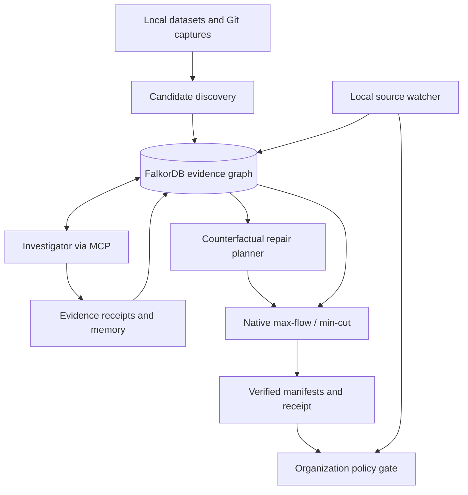

# HOLDOUT Sentinel

**Keep the signal. Fix the split.**

HOLDOUT Sentinel is a graph-backed investigation and release-review system for AI training and evaluation datasets. It finds potential overlaps, traces available source evidence, prioritizes investigations, and computes the minimum-cost record exclusions needed to produce a defensible dataset split. FalkorDB is the authoritative connected-data layer and executes the native maximum-flow computation behind each certified repair.

The application also maintains evidence-bound investigation memory, coordinates specialized workers through graph-backed tasks, checks release decisions against an organizational policy graph, and detects when changing inputs invalidate a previously reviewed release.

> **Scope:** HOLDOUT repairs *draft dataset manifests*. It does not remove information from an already-trained model, prove that every possible contamination case was discovered, or authenticate production organizational approvals.

## Why HOLDOUT?

AI benchmarks can be misleading when an evaluation answer has already appeared in training material. A straightforward duplicate check may miss renamed code or solution content passed through multiple transformations. Conversely, aggressively excluding everything that looks similar can waste valuable examples.

HOLDOUT separates three questions:

1. **What do we know?** Discover candidate conflicts and investigate them using captured source code and provenance.
2. **What should change?** Find the least-cost combination of exclusions that covers confirmed and unresolved conflicts under a declared policy.
3. **Can this release be used?** Verify the output against the evidence, identify relevant organizational requirements, and prevent actions on a stale watched snapshot.

Designed for ML engineers, benchmark maintainers, AI research teams, and developers working on reproducible dataset releases.

## Features

| Capability | What it does |
| --- | --- |
| Dataset import | Load local JSONL, JSON, CSV, or Parquet training/evaluation records. |
| Candidate discovery | Propose overlaps using content hashes, code fingerprints, normalized Python ASTs, token shingles, and source references. Discovery does not assign leakage verdicts. |
| Git capture | Produce read-only snapshots of tracked Python files, Git blob IDs, commits, and bounded same-path history from a local checkout. |
| Evidence investigation | Distinguish **confirmed**, **rejected**, and **unresolved** claims using bounded code comparisons and hash-verified captured provenance. |
| Graph-guided planning | Run native FalkorDB counterfactual solves to rank unresolved claims by their possible effect on the optimal repair. |
| Verified repair | Solve weighted bipartite vertex cover through native `algo.maxFlow`; independently validate the resulting flow/cut certificate. |
| Agent memory | Store episodic, semantic, and procedural findings linked to evidence receipts; revalidate findings before reuse. |
| Specialist coordination | Coordinate deterministic code and provenance workers using FalkorDB task claims, leases, fencing tokens, and handoffs. |
| Organization context | Trace synthetic dataset owners, policies, source decisions, and review eligibility; keep technical correctness independent of approvals. |
| Source monitoring | Watch a local train/eval JSONL pair, report changes and directly affected candidates, block stale-release actions, and require explicit snapshot promotion. |

## Quick start

**Requirements:** Docker with Docker Compose, sufficient space for the image, and an available localhost port. The container uses Ubuntu 24.04 and installs Python and the bundled native FalkorDB runtime; **Python 3.12 is not required on the host**.

From the repository root (the directory containing `compose.yaml`):

```bash
cp .env.example .env
docker compose -p holdout-sentinel --env-file .env up -d --build
```

Open **http://127.0.0.1:8100**.

The default `.env.example` sets `HOLDOUT_HOST_PORT=8100`. Change it if that port is occupied. The HTTP server listens on port `8000` *inside* the container and is mapped to loopback on your machine.

No API key is needed to use **Run deterministic policy**, **Run graph-guided**, or **Run coordinated agents**. The **Run live agent** button requires a configured model provider.

To inspect container output:

```bash
docker compose -p holdout-sentinel --env-file .env logs -f --tail=50 holdout
```

To stop the service while preserving its named runtime volume:

```bash
docker compose -p holdout-sentinel --env-file .env down
```

Avoid `down -v` if you want to preserve saved investigations.

### Optional: live LLM through Requesty

Edit your **local** `.env` file (never commit a real key):

```dotenv
OPENAI_API_KEY=YOUR_REQUESTY_KEY
HOLDOUT_MODEL=openai/gpt-6.1-sol
HOLDOUT_API_BASE=https://router.requesty.ai/v1
HOLDOUT_API_MODE=responses
HOLDOUT_REASONING_EFFORT=low
HOLDOUT_MAX_PROVIDER_CALLS=24
HOLDOUT_MAX_TOOL_CALLS=36
HOLDOUT_MAX_TOKENS=100000
```

The `OPENAI_API_KEY` variable is the application's provider credential field; it can contain a Requesty key. The model ID must be available for your account. The application supports `responses` and `chat_completions` adapters for compatible providers.

Apply changed values by recreating the container with the existing image:

```bash
docker compose -p holdout-sentinel --env-file .env up -d --no-build --force-recreate
```

The browser does not receive the provider credential. Live-model calls may incur provider charges; provider, tool, token, and elapsed-time budgets are configured in `.env`.

## Try it

### 1. Investigate a controlled example

1. Open the local dashboard and select **Load sensitivity example**.
2. Select **Calculate priorities** to see how hypothetically confirming or rejecting uncertain claims changes the current optimization bounds.
3. Select **Run graph-guided** for a no-key investigation, or **Run live agent** to let a model select MCP tools.
4. Open candidate details to inspect source comparisons, graph paths, evidence-method applicability, and unresolved reasons.
5. Select **Stage & verify release**. Review the retained record counts **for each split**, the selected exclusions, and the verification report.

The bundled sensitivity example is designed to show that investigating the right claim can materially lower the conservative exclusion cost. A counterfactual plan is **not** a verdict; actual evidence checks must produce the change.

### 2. Import your own local datasets

In the Import panel, choose separate training and evaluation files and set both policies **before** investigating:

- **Conflict policy:** `answer_leakage` (bounded solution evidence) or `exact_record` (byte-identical whole records).
- **Preservation policy:** `equal`, `balanced`, `eval_first`, or `train_first` (declared exclusion weights).

A minimal JSONL input row looks like:

```json
{"id":"sample-001","title":"Clipping function","content":"def clip(x, low, high):\n    return max(low, min(x, high))\n","source_id":"workshop-2026","protected":false}
```

Each split uses its own file. Optional attributes include `solution_symbols` for identifying answer-bearing functions and source-reference fields such as `derived_from` or `parent_ids`. The importer may infer a single standalone Python function as solution-bearing; complex modules generally need explicit `solution_symbols` to support function-level checks.

`source_id` and similar metadata are *candidate lineage hints*, **not** proof that a solution was preserved. Inputs must be authorized to use; repository files and source text are treated as evidence, not executable instructions.

For larger inputs, the CLI prepares a local snapshot before starting the investigation:

```bash
python -m holdout prepare \
  --train train.jsonl --eval eval.jsonl \
  --policy equal --separation-policy answer_leakage \
  --output imported-release
```

This CLI requires the project's Python 3.12 environment and dependencies. The Docker-backed browser import is the simplest option for a standard installation; it has a request-size limit.

### 3. Monitor source changes

The Compose configuration mounts `watch-inputs/` read-only inside the container. The watcher reads **`watch-inputs/train.jsonl`** and **`watch-inputs/eval.jsonl`** on a local polling interval (15 seconds by default).

1. In **Sentinel · Source change watch**, choose **Check sources now**.
2. Review the digest and select **Promote reviewed snapshot** to activate that pair as a new run.
3. Investigate and stage a verified repair.
4. Modify a record in a watched file while keeping its stable `id`; check sources again.
5. Sentinel displays added/removed/modified records and directly affected existing conflict edges. The active watched release is marked stale and new evidence/release/review actions are blocked.
6. Review and promote the new snapshot to start a fresh investigation. Historical verdicts and approvals are **not** silently carried forward.

Watching is automatic; **promotion and reinvestigation require explicit action**. This version monitors a fixed local pair, not GitHub or Hugging Face endpoints directly.

## Architecture and FalkorDB data model



FalkorDB is **not an optional graph visualization**. It stores the authoritative connected investigation state, serves bounded provenance queries, coordinates work, links evidence memories to their receipts, resolves organization paths, and runs the capacity-network optimization. The client UI is a projection of that state.

### Important node types

| Nodes | Role |
| --- | --- |
| `Record` (also labelled `Entity`) | Captured training/evaluation records, content identity, costs, and required-retention flags. |
| `Candidate` | One suspected cross-split conflict and its evidence verdict. |
| `Entity` | Source files, Git captures, and related provenance artifacts. |
| `ReleaseMeta`, `Event` | Active run, evidence revision, decisions, and investigation activity. |
| `EvidenceReceipt`, `Memory` | Evidence-bound episodic, semantic, and procedural memory. |
| `InvestigationTask` | Specialist assignment, leased claims, and handoff state. |
| `OrgProject`, `OrgDataset`, `OrgPerson` | Synthetic organizational context and dataset ownership. |
| `OrgPolicy`, `OrgDecision`, `OrgPolicySelection`, `OrgApproval` | Sourced policies, selected review criteria, and local demonstration attestations. |

**Important relationships:** `TRAIN`, `EVAL`, `DERIVED_FROM`, `CONTAINS`, `USES_SCAFFOLD`, `ABOUT`, `SUPPORTED_BY`, `FOR_CANDIDATE`, `HAS_DATASET`, `OWNED_BY`, `JUSTIFIED_BY`, and `ABOUT_TECHNICAL_RELEASE`.

### Core Cypher and graph algorithm

Retrieve bounded provenance paths:

```cypher
MATCH p=(r:Entity {id:$id})-[:DERIVED_FROM|CONTAINS|USES_SCAFFOLD*0..8]->(n)
RETURN [x IN nodes(p) | x.data],
       [x IN relationships(p) | x.data]
LIMIT 5001;
```

Run maximum flow on a temporary, release-scoped capacity graph:

```cypher
MATCH (s:Flow {key:'__source'}), (t:Flow {key:'__sink'})
CALL algo.maxFlow({
  sourceNodes:[s], targetNodes:[t],
  relationshipTypes:['CAPACITY'], nodeLabels:['Flow'],
  capacityProperty:'capacity'
})
YIELD edges, edgeFlows, maxFlow
RETURN maxFlow, [e IN edges | id(e)], edgeFlows;
```

These are representative queries. The application builds UUID-scoped flow graphs and parameterizes inputs. See [`docs/queries.cypher`](docs/queries.cypher), [`docs/architecture.md`](docs/architecture.md), and the implementation in [`holdout/optimizer.py`](holdout/optimizer.py) and [`holdout/graph.py`](holdout/graph.py).

### Why minimum cut?

For a fixed train/eval partition, every active conflict `(t, e)` requires the exclusion of at least one endpoint. With additive exclusion weights, this is **minimum-weight bipartite vertex cover**:

```text
minimize    sum(cost[v] * excluded[v])
subject to  excluded[t] + excluded[e] >= 1  for every active conflict
            excluded[v] = 0                for protected records
```

HOLDOUT reduces the problem to a source → training → evaluation → sink network. Capacities on source/train and evaluation/sink arcs encode record costs; large-capacity train/eval arcs encode conflict constraints. It invokes FalkorDB's native `algo.maxFlow`, derives the residual minimum cut, and independently checks flow conservation, conflict coverage, retained protected records, and agreement between flow, cut, and exclusion cost.

Two optimizations expose uncertainty:

- **Confirmed-only lower bound:** covers established conflicts.
- **Conservative optimum:** covers established **and unresolved** conflicts; this is the only policy eligible for release export.

Read-only counterfactual solves estimate the possible savings from rejecting a candidate and the lower-bound change from confirming it. The planner ranks investigations using declared method-effort proxies; it does not know the probability of either outcome or guarantee globally optimal information acquisition.

## Investigation modes

| Mode | Role | Model key? |
| --- | --- | --- |
| **Run live agent** | One LLM investigator chooses domain MCP tools, reviews evidence, consults memory and planning, and stages a verified repair. | Yes |
| **Run graph-guided** | Deterministic MCP investigator selects claims using certified counterfactual repair effects. | No |
| **Run coordinated agents** | Two deterministic MCP specialists (code and provenance) claim tasks, hand off work, and share evidence-bound state. | No |
| **Run deterministic policy** | Reproducible evidence-first investigation baseline. | No |

Specialist coordination is **not two concurrent LLM model sessions**. Evidence tools derive verdicts; neither an LLM nor a remembered procedure can set a supported verdict by assertion.

## Outputs and verification

A successful repair writes:

| Artifact | Description |
| --- | --- |
| `train.jsonl` | Retained training examples, preserving their captured content. |
| `eval.jsonl` | Retained evaluation examples, preserving their captured content. |
| `repair.json` | Candidate verdicts, exclusions, costs, evidence receipts, policy bindings, manifest hashes, and a flow/min-cut certificate. |

Verification checks complete partitioning, protected-record retention, active conflict coverage, preserved content, declared costs, hashes, and optimality. When independently retained source evidence is provided, it also replays the supported evidence checks. A self-contained hash is a **consistency check, not a cryptographic signature**.

Standalone checks:

```bash
python -m holdout verify path/to/release --fixture path/to/original/dataset.json
python -m holdout verify-plan path/to/planning-report.json --fixture path/to/original/dataset.json
```

They require an installed Python environment, but do not call an LLM or FalkorDB.

## Organization review

HOLDOUT connects a verified technical repair to a **synthetic** project, dataset-owner relationships, source-linked policies, and local review decisions. A policy may require minimum retained counts per split or a reviewer before a release can be considered eligible. Changing a policy can block a previously eligible repair **without altering its technical optimum**.

The local review selector is for demonstration only; it is **not an authenticated approval, signature, identity provider, or production authorization system**. The LLM can read organizational context but cannot grant an approval.

## Testing

Run the included test suite inside the configured Docker container:

```bash
docker compose -p holdout-sentinel --env-file .env exec -T holdout \
  /app/.venv/bin/python -m pytest -q
```

The source package contains offline contract tests and native FalkorDB/MCP tests. Check the test output for the actual result on your platform; **native acceptance and production-scale throughput are not claimed solely from offline test results**.

## Limitations and operating boundaries

- Candidate generation is a bounded retrieval process, **not an exhaustive proof that no leakage exists**. Similarity and source references are hypotheses; absent or unsupported provenance remains unknown.
- Python normalized-AST comparison supports a restricted subset; arbitrary semantic equivalence, code execution and complete transformation lineage are out of scope.
- The exact minimum-cut guarantee applies to **two fixed dataset pools, pairwise cross-pool conflicts, predeclared additive costs, and protected records**. It does not enforce arbitrary split quotas or automatically generate replacements. A mathematically optimal repair may leave a pool empty; review the per-split counts and governance gate.
- Investigation memory is evidence-bound and scoped to the active release. Coordinated workers operate in a single local service, not a distributed multi-tenant cluster.
- Organization policies and reviewer identities are synthetic. Do not use the local approval controls as production security boundaries.
- Monitoring supports a fixed pair of **local JSONL files**. Change impact covers direct candidate relationships; new snapshot promotion rebuilds the graph and requires renewed investigation. External repository polling and incremental flow maintenance are not implemented.
- The service is intended to be run **locally** and bound to loopback. Do not expose its unauthenticated demo endpoints or import restricted/private datasets without additional security controls.
- No general FalkorDB speed advantage over capable in-memory or relational alternatives is claimed. Correctness, evidence traceability, and graph-backed actions are the current demonstrated design goals.

## Hackathon alignment

HOLDOUT Sentinel brings three complementary graph-backed workflows into one product:

- **Agents That Act on Connected Data:** provenance investigation, MCP tool selection, native graph optimization, and verified release actions.
- **Agent Memory and Coordination:** receipt-bound memory, safe procedure suggestions, task claims, and specialist handoffs.
- **Company Brain:** project and dataset ownership, policy provenance, and release-governance decisions based on actual retained records.

## License

See [LICENSE](LICENSE) for licensing terms.

---

**HOLDOUT Sentinel — Keep the signal. Fix the split.**
